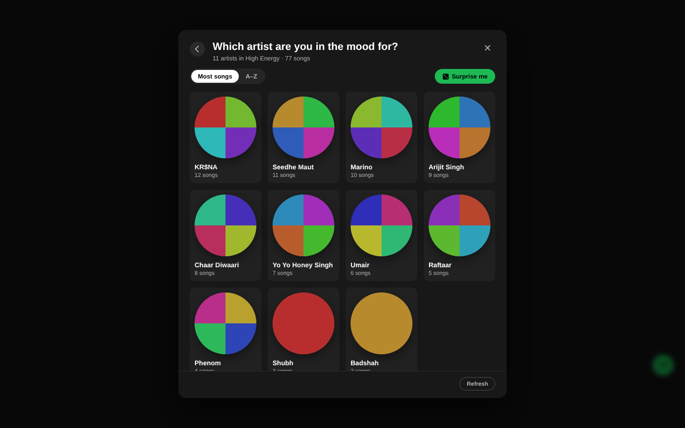

# Mood Shuffle

A Spicetify extension that works inside **one playlist at a time**. Pick a playlist, pick the artist you're in the mood for, and it shuffles only that artist's songs from that playlist, so no other artists sneak in.



## How to use

- **Right-click a playlist** (or Liked Songs) and choose **Mood Shuffle**.
- Or open a playlist and click the **green round button** in the bottom-right corner (or press **Cmd+Shift+M** / **Ctrl+Shift+M**). It opens on the playlist you're viewing, or the one that's playing.
- Not on a playlist? You'll get a grid of your playlists to pick from first.
- Click an artist, or hit **Surprise me** for a random one. Use the back arrow to switch playlists.

The popup resizes itself: a playlist with a few artists gets a small popup, one with lots of artists gets a wide, scrollable grid.

## Install

**Marketplace:** open Marketplace in Spotify, search for **Mood Shuffle** and click Install.

**Manual:**

```bash
cp moodShuffle.js ~/.config/spicetify/Extensions/
spicetify config extensions moodShuffle.js
spicetify apply
```

## Tip

Turn off **Autoplay** in Spotify Settings → Playback. If it's on, Spotify starts playing "similar" songs by other artists when your mix ends.
